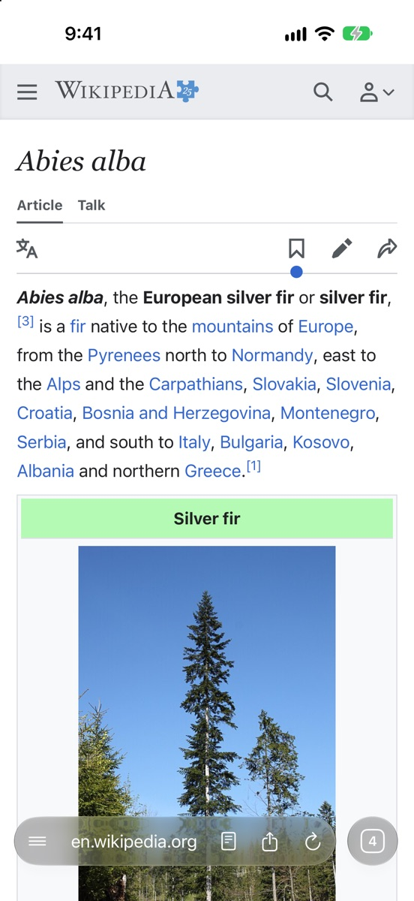
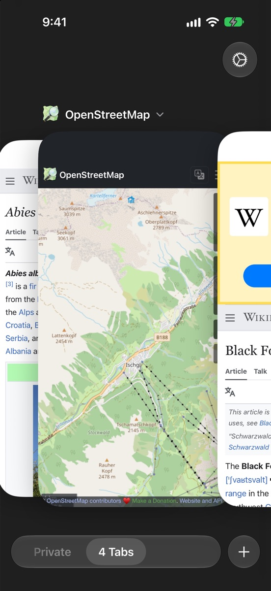
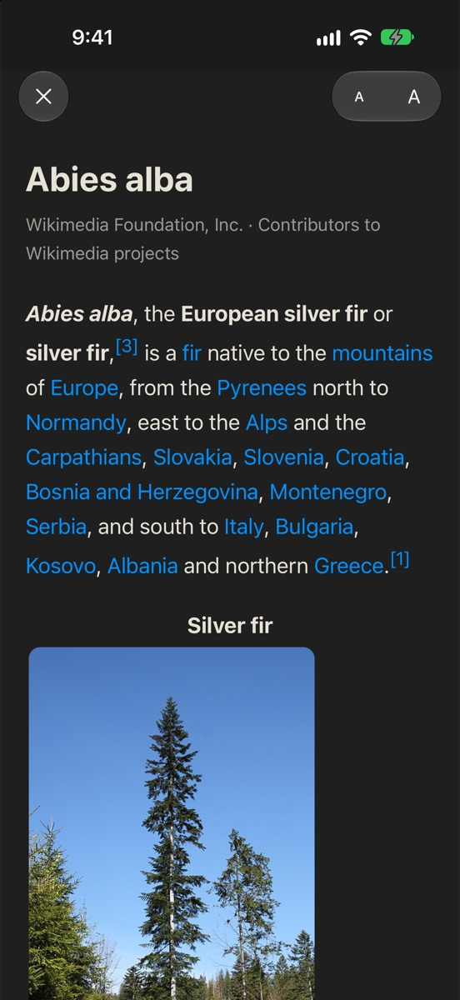
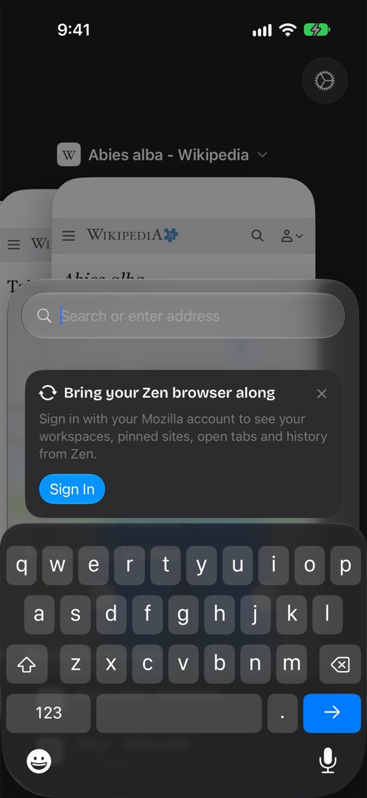

<p align="center">
  
</p>

<h1 align="center">Fir</h1>

<p align="center">
  A calm WebKit browser for iPhone that syncs with Zen Browser and Firefox through your Mozilla account.
  <br>
  Fir is an independent app, not affiliated with Zen or Mozilla.
</p>

<p align="center">
  
  
  
  
</p>

## Features

- Firefox Sync: the workspaces, essentials and pinned tabs of Zen, the tabs open on your other
  devices, history and passwords. Tabs can be sent back to a computer.
- A Safari-style tab switcher, with swipes between tabs and between workspaces.
- Ad and tracker blocking with filter lists you choose. The lists are downloaded on the device and
  compiled into WebKit content rules.
- HTTPS-Only mode, private tabs locked with Face ID, and an optional lock for the whole app.
- Reader view, on-device page translation, downloads, a search widget, and New Tab and New Private
  Tab actions on the app icon.

## Build

Fir needs Xcode 27 with the iOS 26 SDK, and [XcodeGen](https://github.com/yonaskolb/XcodeGen).

```sh
./scripts/fetch-rust-components.sh   # Mozilla's Rust components, about 600 MB, not checked in
xcodegen generate
open Fir.xcodeproj
```

To run it on a device, put your own team and bundle ID into `project.yml` (`DEVELOPMENT_TEAM`,
`PRODUCT_BUNDLE_IDENTIFIER`). `docs/testflight.md` covers shipping to TestFlight.

## Mozilla account sign-in

Mozilla does not issue Sync-capable OAuth clients to third parties, so Fir signs in with Firefox
for iOS's public client ID. Mozilla can revoke it at any time.

## License

Fir's own code is under the Mozilla Public License 2.0, in `LICENSE`.

Third-party parts keep their own licenses:

- Mozilla application-services Rust components and Glean, fetched at build time: MPL-2.0.
- Readability.js, in `Fir/Reader`: Apache-2.0, see `Fir/Reader/Readability-LICENSE.md`.
- Bricolage Grotesque, the heading typeface in `Shared/Fonts`: SIL Open Font License 1.1.
- Filter lists such as EasyList and Fanboy's lists: downloaded from their publishers at run time,
  under the publishers' licenses.
